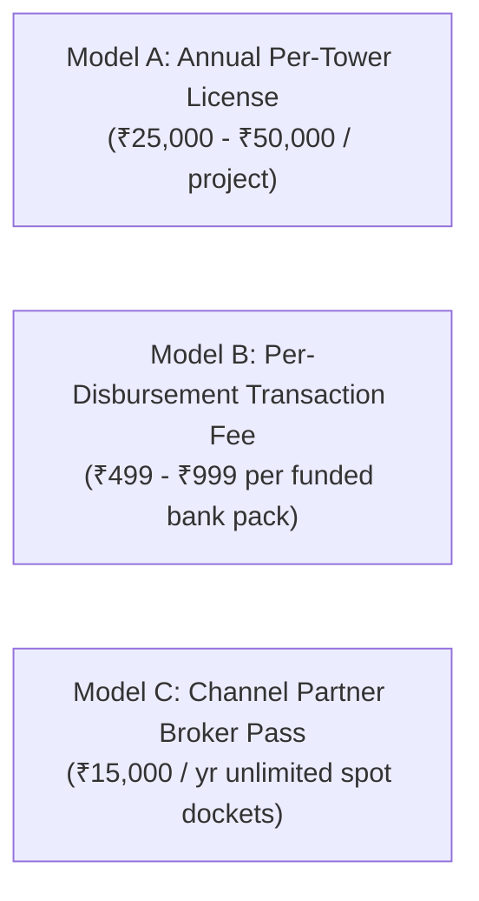

# Monetization, Pricing Ladders & Packaging Strategy (`/monetization-models`)

Use this skill to determine pricing models, create pilot-to-paid conversion pipelines, and price DeedFlow for maximum willingness-to-pay (WTP) in the Indian market.

---

## 1. Why Standard Western SaaS Pricing Fails in India
- **Mistake:** Charging $49/user/month on a recurring credit card subscription.
- **Why it Fails:**
  - Indian builders have 1 or 2 clerks sharing a single login.
  - Indian corporate finance requires GST invoices, POs, and NEFT/RTGS bank transfers or Razorpay UPI payments.
  - Indian SMBs cancel subscriptions during the off-season (monsoons / Shradh / Pitru Paksha).

---

## 2. The 3 Viable Indian Real Estate Monetization Models

### Model A: Flat Annual Per-Project / Per-Tower License (Recommended for Mid-Sized Builders)
- **Structure:**
  - **Single Tower (Up to 80 Flats):** ₹29,999 / year + 18% GST (One-time annual invoice).
  - **Multi-Tower Society (Up to 250 Flats):** ₹69,999 / year + 18% GST.
- **What is Included:**
  - Unlimited document generations & revisions.
  - Visual basement parking grid for all basement levels.
  - Custom `.docx` letterhead onboarding.
  - Unlimited WhatsApp draft verification links.
- **Why Builders Pay:** Framed as an annual "project software license" (similar to buying an AutoCAD license or website maintenance). It fits directly into their project construction budget.

### Model B: The "Pay-Per-Disbursement" Transactional Model (Zero-Friction Wedge)
- **Structure:**
  - Free software setup and free car parking generation.
  - Charge **₹499 to ₹999 per completed Home Loan Bank Kit** downloaded.
- **Why Builders Pay:** Tied directly to a cash inflow event. When the builder is about to receive a ₹75 Lakh tranche from SBI, paying ₹499 to guarantee the bank kit is approved without rejection is an absolute no-brainer.

### Model C: Channel Partner / Broker Booking Token Pass
- **Structure:**
  - Flat ₹15,000/year for real estate brokerage firms.
  - Enables unlimited spot-booking dockets on iPads at site offices.

---

## 3. The "Pilot-to-Paid" 4-Stage Conversion Ladder

| Stage | Timing | Action | Commercial Agreement |
| :--- | :--- | :--- | :--- |
| **Stage 1: The Coffee Table Demo** | Day 1 | 3-minute live mobile demo at site office | Free test run on 1 upcoming booking |
| **Stage 2: The Ongoing Tower Pilot** | Days 2–30 | Import project inventory; team uses for 10 bookings | ₹0 (No credit card or contract required) |
| **Stage 3: The Value Audit** | Day 25 | Present metrics report: *"You generated 18 letters, saved 12 hours, zero bank rejections"* | Present Annual Invoice (₹29,999 + GST) |
| **Stage 4: Formal Rollout** | Day 30 | Receive GST payment via NEFT/UPI; lock in annual support | Issue official GST tax invoice and SLA |

---

## 4. Upsell & Add-On Opportunities
1. **Custom Bank Template Engineering:** ₹5,000 one-time fee to calibrate exact bank-specific tripartite clauses for regional banks (Canara, Bank of Baroda, Karnataka Bank).
2. **Kaveri 2.0 Pre-Registration Data Export:** ₹10,000/year add-on for Bengaluru builders.
3. **Physical QR Sealed Print Verification:** Verification API and tamper-proof verification page for banks and sub-registrars.
