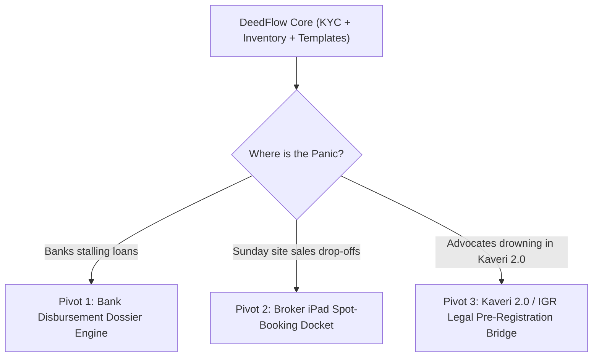

# Pivot Brainstorming & Feedback Synthesis Framework (`/pivot-brainstorm`)

Use this skill when analyzing user interviews, builder pilot feedback, or sales rejections to decide whether to double down, tweak, or pivot DeedFlow.

## The 3 High-Urgency Pivot Paths

### Pivot 1: The "Bank Loan Disbursement Fast-Track" (Highest Revenue Potential)
- **The Core Hair-on-Fire Pain:** Builders don't make money when flats are booked; they make money when home loan banks release milestone tranches (foundation, 5th slab, terrace slab). Banks like SBI, HDFC, and LIC delay payouts for 3 to 6 weeks over missing architect certificates, wrong tripartite clause wording, or demand letter discrepancies.
- **The Solution:** A specialized module that ingests the builder's milestone demand schedule and generates bank-specific approved dossiers for SBI, HDFC, ICICI, and Axis in 1 click.
- **Why It Wins:** Builders will pay ₹1,000–₹2,500 per disbursement because speeding up a ₹1 Crore tranche by 14 days saves them ₹1 Lakh+ in bank loan interest.

### Pivot 2: The "Sunday Site-Office Spot-Booking Docket" (High Sales Volume)
- **The Core Hair-on-Fire Pain:** Indian home buyers visit 4 site offices on Sunday. When a buyer decides on Flat 302, if the broker cannot lock them in with an official booking docket right on an iPad, the buyer goes home, consults their family, and cancels on Monday.
- **The Solution:** A mobile/tablet-optimized web app for sales managers to snap PAN/Aadhaar photos at the coffee table, collect an instant ₹1 Lakh UPI token advance, allocate the parking slot, and generate a signed booking certificate in 60 seconds.
- **Why It Wins:** Directly tied to closing sales and preventing buyer cancellations.

### Pivot 3: The "Kaveri 2.0 / IGR Legal Bridge for Advocates"
- **The Core Hair-on-Fire Pain:** Sub-Registrar advocates in Bengaluru spend hours manually keying in boundary schedules (North, South, East, West with Survey numbers) into Kaveri 2.0.
- **The Solution:** An advocate-facing tool that auto-extracts survey schedules from title deeds and formats them directly for Kaveri 2.0 / IGR batch upload.
- **Why It Wins:** Sells to law firms and deed writers who bill their clients ₹10,000+ per registration.

## Feedback Diagnostic Scorecard
When a builder gives feedback, rate their response on these 3 criteria:
1. **Urgency (Is money delayed today?):** 1 = "Nice to have" $\to$ 5 = "Our loan tranche is stuck right now".
2. **Frequency (How often does it occur?):** 1 = Once a year $\to$ 5 = Every weekend.
3. **Budget Discretion (Who signs off?):** 1 = MD/Promoter only $\to$ 5 = Site sales manager with corporate credit card/cash advance.
